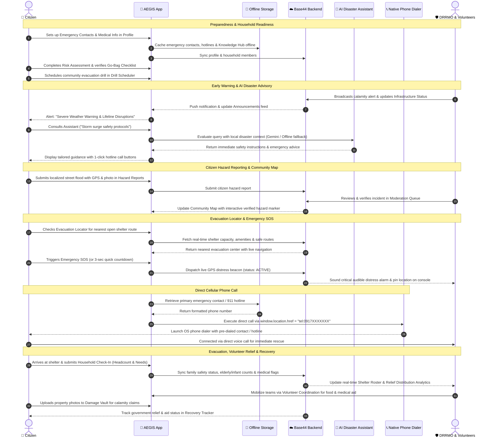

# AEGIS: Complete Application Sequence Flow

This diagram illustrates the complete, continuous end-to-end journey of the AEGIS platform as a single cohesive process incorporating all core features.

> **💡 Quick Export:**  
> Open [`docs/aegis_sequence_diagrams.html`](file:///c:/Users/flean/Documents/aegis-full/docs/aegis_sequence_diagrams.html) or navigate to [http://localhost:5175/aegis_sequence_diagrams.html](http://localhost:5175/aegis_sequence_diagrams.html) to download this diagram as a high-resolution **PNG**, vector **SVG**, or print it as a **PDF** with one click.

---

